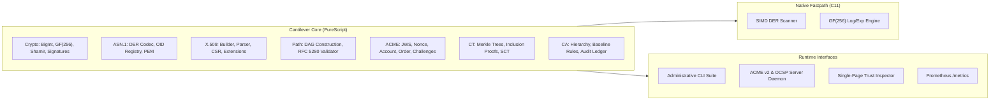
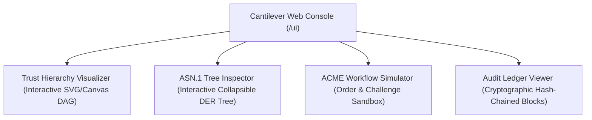

# Cantilever

**Cantilever** is an automated Public Key Infrastructure (PKI) and ACME v2 (RFC 8555) Certificate Authority implemented in PureScript. Designed around purely functional semantics, strong static typing, and formal RFC compliance, Cantilever provides an end-to-end cryptographic trust engine capable of automated certificate issuance, strict X.509 path validation, high-throughput revocation checking, and Certificate Transparency auditing.

```mermaid
flowchart TD
    Client["ACME v2 Client (RFC 8555)"] -->|POST JWS Payload| Router["HTTP & ACME Request Router"]
    Router -->|Anti-Replay Verification| NoncePool["Anti-Replay Nonce Pool"]
    Router -->|Account Management| AcctStore["ACME Account Store"]
    Router -->|Order & Challenge Engine| OrderSM["Order State Machine"]
    OrderSM -->|HTTP-01 / DNS-01| ChallengeEngine["Challenge Verifier"]
    OrderSM -->|PKCS#10 Proof of Possession| CsrEngine["CSR Finalization Engine"]
    
    CsrEngine -->|Issuance Request| Authority["Certificate Authority Core"]
    Authority -->|Root / Intermediate Keys| SecretSharing["Shamir Secret Sharing GF(256)"]
    Authority -->|X.509 v3 Synthesis| Builder["X.509 DER Builder"]
    Authority -->|Audit Hash Chain| AuditLedger["Tamper-Evident Ledger"]
    
    Builder -->|Precertificate| CTLog["RFC 6962 CT Engine (Merkle Tree)"]
    CTLog -->|Signed Cert Timestamp (SCT)| Builder
    Builder -->|Signed Fullchain| Router
    Router -->|PEM Fullchain Response| Client

    subgraph RevocationServices ["Revocation Services"]
        CRLGen["RFC 5280 CRL Generator"]
        OCSPGen["RFC 6960 OCSP Responder"]
    end
    Authority --> RevocationServices

    subgraph VerificationEngine ["RFC 5280 Path Validation"]
        ChainParser["X.509 DER & PEM Parser"]
        PathGraph["Directed Trust Graph & Cycle Detector"]
        NameSubtree["Name Constraints Subtree Matcher"]
        PathValidator["RFC 5280 Section 6 Validator"]
    end
```

---

## Technical Highlights

### Pure Functional Cryptography & PKI Architecture
* **Strict RFC 8555 ACME v2 Engine**: Complete implementation of directory discovery, anti-replay nonces with bounded time-to-live, RFC 7515 JWS verification with JWK thumbprinting (RFC 7638), account key roll-over, order states (`pending`, `ready`, `processing`, `valid`, `invalid`), and automated HTTP-01 / DNS-01 challenge verification.
* **RFC 5280 Certification Path Validation**: Purely functional implementation of the RFC 5280 Section 6 validation algorithm. Features directed acyclic graph (DAG) cycle detection, trust anchor chaining, basic constraints verification (`isCA`, `pathLenConstraint`), key usage masking, clock skew tolerance, and recursive name constraint subtree enforcement (permitted and excluded DNS/IP subtrees).
* **Canonical ITU-T X.690 DER Codec**: Low-level binary codec enforcing strict Distinguished Encoding Rules (DER). Enforces minimal-length octet representations, non-canonical long-form rejection, indefinite-length rejection, and lexicographical byte sorting of `SET OF` components (Section 11.6).
* **RFC 6962 Certificate Transparency**: Merkle tree log implementation supporting canonical leaf hashing (`0x00`), interior node hashing (`0x01`), largest-power-of-2 tree decomposition, logarithmic inclusion proof generation, audit path verification, and Signed Certificate Timestamp (SCT) serialization.
* **Revocation Infrastructure (RFC 5280 & RFC 6960)**: Automated distribution points for X.509 Certificate Revocation Lists (CRL v2) with reason codes, and an online RFC 6960 OCSP responder evaluating leaf status in real time.
* **Shamir (k, n) Threshold Secret Sharing**: Air-gapped Root CA key splitting over Galois Field GF(256) modulo irreducible polynomial `p(x) = x^8 + x^4 + x^3 + x + 1` (0x11B) using Lagrange basis polynomial interpolation.
* **Native C11 Fastpath Engine**: Optional SIMD-accelerated C11 runtime for high-throughput DER header decoding, VLQ integer parsing, and O(1) Galois field multiplication.
* **Comprehensive Telemetry & Interactive Console**: Built-in Prometheus text exposition endpoint (`/metrics`) and an embedded single-page administrative console rendering interactive trust graphs, ASN.1 syntax trees, ACME order lifecycles, and cryptographic audit ledgers.

---

## System Architecture



### Module Organization

```
src/
├── Cantilever/
│   ├── Core/
│   │   ├── Crypto/
│   │   │   ├── BigInt.purs          # Arbitrary-precision modular arithmetic (powMod)
│   │   │   ├── Galois.purs          # GF(256) field arithmetic & polynomial evaluation
│   │   │   ├── Shamir.purs          # (k, n) threshold secret sharing & Lagrange interpolation
│   │   │   ├── Hash.purs            # SHA-1, SHA-2, MD5, and HMAC-SHA256 interfaces
│   │   │   ├── AEAD.purs            # Authenticated encryption (AES-256-GCM) & PBKDF2
│   │   │   ├── Key.purs             # Keypair generation (RSA, ECDSA, Ed25519) & JWK thumbprinting
│   │   │   └── Signature.purs       # Digital signature creation & verification
│   │   ├── ASN1/
│   │   │   ├── Types.purs           # ASN.1 semantic tags and algebraic value representations
│   │   │   ├── OID.purs             # OID dotted decimal parsing, VLQ codecs, standard registry
│   │   │   ├── DER.purs             # Canonical DER binary encoder & length validator
│   │   │   ├── PEM.purs             # RFC 7468 PEM container codec with 64-char line wrapping
│   │   │   └── Printer.purs         # Human-readable hierarchical ASN.1 diagnostic dumper
│   │   ├── X509/
│   │   │   ├── Types.purs           # TBSCertificate, SubjectPublicKeyInfo, AlgorithmIdentifier
│   │   │   ├── Name.purs            # Distinguished Name RFC 4514 formatting & canonical comparison
│   │   │   ├── Validity.purs        # UTCTime and GeneralizedTime parsing & skew verification
│   │   │   ├── Extensions.purs      # Typed X.509 v3 extensions (BasicConstraints, SAN, EKU)
│   │   │   ├── Builder.purs         # Certificate generation for Root CA, Intermediate, and Leaf
│   │   │   ├── Parser.purs          # Complete X.509 v3 DER & PEM certificate parser
│   │   │   └── CSR.purs             # PKCS#10 CSR builder, parser & proof-of-possession verifier
│   │   ├── Path/
│   │   │   ├── Types.purs           # Validation configuration, error diagnostics, audit logs
│   │   │   ├── NameConstraints.purs # RFC 5280 recursive DNS/IP subtree matching algorithms
│   │   │   ├── Graph.purs           # Certification path DAG search & cycle detection
│   │   │   └── Validator.purs       # Complete RFC 5280 Section 6 path validation engine
│   │   ├── Revocation/
│   │   │   ├── Types.purs           # CRL entries, OCSP request/response data structures
│   │   │   ├── CRL.purs             # RFC 5280 CRL builder, signer, parser, and verifier
│   │   │   ├── OCSP.purs            # RFC 6960 OCSP request decoder & single-response generator
│   │   │   └── Store.purs           # In-memory revocation registry with automated dispatch
│   │   ├── CT/
│   │   │   ├── Merkle.purs          # RFC 6962 Merkle tree hashing, inclusion & consistency proofs
│   │   │   └── SCT.purs             # Signed Certificate Timestamp binary codecs & poison stripping
│   │   ├── ACME/
│   │   │   ├── Types.purs           # ACME v2 resource models, state machines, problem documents
│   │   │   ├── Nonce.purs           # Anti-replay nonce pool with sliding TTL and single-use checks
│   │   │   ├── JWS.purs             # RFC 7515 JSON Web Signature verification & JOSE headers
│   │   │   ├── KeyAuth.purs         # Key authorization string & DNS-01 SHA-256 digest calculation
│   │   │   ├── Account.purs         # Account store, registration, contact updates, key rollover
│   │   │   ├── Order.purs           # Order and authorization lifecycles, CSR finalization
│   │   │   └── Challenge.purs       # Automated HTTP-01 & DNS-01 challenge verification engine
│   │   └── CA/
│   │       ├── Authority.purs       # Multi-tier CA issuance hierarchy and key management
│   │       ├── Policy.purs          # CABF Baseline Requirements certificate linter & rules
│   │       └── Audit.purs           # Tamper-evident cryptographic hash-chained audit log ledger
│   ├── Server/
│   │   ├── HTTP.purs                # Low-level HTTP server interface and connection management
│   │   ├── Metrics.purs             # Prometheus telemetry metrics collector and text exposition
│   │   └── Router.purs              # Unified ACME, CRL, OCSP, CT, and Metrics request router
│   ├── Web/
│   │   └── Dashboard.purs           # Interactive web UI (Trust Graph, ASN.1 Tree, ACME Simulator)
│   └── CLI/
│       ├── Args.purs                # Command line argument parser and documentation
│       └── Commands.purs            # CLI action handlers for server, PKI setup, path validation
├── Main.purs                        # Executable application entrypoint
native/c/
├── cantilever_native.h              # C11 header definitions
├── cantilever_der_fastpath.c        # Fast DER tag scanning and length validation
├── cantilever_gf256.c               # SIMD-compatible GF(256) table arithmetic & Lagrange
├── test_fastpath.c                  # Native C11 unit test suite
└── Makefile                         # Production build configuration for shared libraries
tools/
├── acme_client.py                   # Automated RFC 8555 test client
├── pki_bench.py                     # High-concurrency benchmark and load test harness
└── cert_fuzzer.py                   # Differential ASN.1 DER mutational fuzzer
test/
└── Test/
    ├── Cantilever/
    │   ├── CryptoSpec.purs          # Tests for BigInt, GF(256), Shamir, AES-GCM, Signatures
    │   ├── ASN1Spec.purs            # Tests for DER encoding, canonical Set sort, PEM
    │   ├── X509Spec.purs            # Tests for DN, Validity, Certificate Builder, Parser, CSR
    │   ├── PathValidationSpec.purs  # Tests for RFC 5280 chain validation and Name Constraints
    │   ├── ACMESpec.purs            # Tests for Nonce replay, KeyAuth, Account Store
    │   ├── CTSpec.purs              # Tests for Merkle tree hashing, inclusion proofs, SCTs
    │   └── TestRunner.purs          # Assertion helpers and summary reporting
    └── Main.purs                    # Master unit test suite runner
```

---

## Standards and RFC Compliance

Cantilever adheres strictly to the normative specifications defined across core Internet Engineering Task Force (IETF) and CA/Browser Forum standards:

| Standard | Description | Cantilever Implementation Status |
|:---|:---|:---|
| **RFC 8555** | Automatic Certificate Management Environment (ACME v2) | Fully compliant: Directory, NewNonce, NewAccount, NewOrder, Authz, HTTP-01, DNS-01, Finalize, Cert Download |
| **RFC 5280** | X.509 v3 Public Key Infrastructure & CRL Profile | Fully compliant: Path validation algorithm, basic constraints, key usage, name constraints, serial tracking |
| **RFC 6960** | X.509 Internet PKI Online Certificate Status Protocol (OCSP) | Fully compliant: ASN.1 request parsing, single-response generation, cryptographic signing |
| **RFC 6962** | Certificate Transparency | Fully compliant: Canonical Merkle tree hashing, inclusion proofs, consistency proofs, precert poison stripping |
| **RFC 7515** | JSON Web Signature (JWS) | Fully compliant: Protected header validation, anti-replay nonce binding, base64url codecs |
| **RFC 7638** | JSON Web Key (JWK) Thumbprint | Fully compliant: Canonical JSON ordering and SHA-256 digest thumbprinting |
| **RFC 7468** | Textual Encodings of PKIX Artifacts (PEM) | Fully compliant: 64-character wrapped ASCII containers with BEGIN/END headers |
| **ITU-T X.690** | ASN.1 Distinguished Encoding Rules (DER) | Fully compliant: Strict minimal-length encoding, no indefinite lengths, canonical Set sorting |
| **CABF BR** | CA/Browser Forum Baseline Requirements | Enforced: Maximum 398-day validity for leaf certificates, RSA key length >= 2048, prohibited wildcards |

---

## Quickstart

### Prerequisites

* Node.js (v18.0.0 or higher)
* PureScript compiler (`purs` v0.15.17)
* Spago build tool (`spago` v1.0.5)
* C compiler (`clang` or `gcc` supporting C11) for optional native fastpath acceleration
* Python 3.8+ (optional, for client and fuzzer test scripts)

### Installation and Compilation

Clone the repository and compile the PureScript codebase:

```bash
git clone https://github.com/Aneesh495/cantilever.git
cd cantilever

# Install dev dependencies
npm install

# Compile the PureScript project
spago build
```

Compile and verify the native C11 fastpath engine:

```bash
cd native/c
make test
cd ../..
```

### Running Test Suites

Execute the comprehensive PureScript test suite:

```bash
spago test
```

All 6 specialized test suites will execute and verify internal consistency:
* Cryptographic Primitives Engine
* ASN.1 DER & PEM Codec Engine
* X.509 Certificate and PKCS#10 CSR Engine
* RFC 5280 Path Validation Engine
* RFC 8555 ACME Protocol Engine
* RFC 6962 Certificate Transparency Engine

Run the differential ASN.1 mutational fuzzer:

```bash
python3 tools/cert_fuzzer.py
```

---

## CLI Administrative Suite

Cantilever provides an executable CLI (`cantilever`) for common PKI operations, certificate issuance, path verification, and cryptographic microbenchmarking.

### Command Reference

#### 1. Display Version and Build Information
```bash
./bin/cantilever.js version
```

#### 2. Start the ACME v2 Daemon and Web Console
Starts the automated HTTP ACME server, OCSP responder, Prometheus exporter, and Web UI:
```bash
./bin/cantilever.js server --port 8080 --host 127.0.0.1
```
* **ACME Directory**: `http://127.0.0.1:8080/directory`
* **Web UI Dashboard**: `http://127.0.0.1:8080/ui`
* **Prometheus Metrics**: `http://127.0.0.1:8080/metrics`
* **OCSP Responder**: `http://127.0.0.1:8080/ocsp`
* **CRL Distribution**: `http://127.0.0.1:8080/crl`

#### 3. Initialize a Multi-Tier PKI Hierarchy
Generates a 4096-bit self-signed Root CA and a 2048-bit Intermediate CA with standard extensions:
```bash
./bin/cantilever.js init-ca --out-dir ./pki
```
Outputs:
* `./pki/root_ca.key` and `./pki/root_ca.crt`
* `./pki/intermediate_ca.key` and `./pki/intermediate_ca.crt`

#### 4. Validate an X.509 Certification Path (RFC 5280)
Verifies the cryptographic trust chain from a trust anchor down to a leaf certificate:
```bash
./bin/cantilever.js validate-path ./pki/root_ca.crt ./pki/intermediate_ca.crt
```

#### 5. Inspect an X.509 Certificate and ASN.1 Syntax Tree
Decodes and renders the complete ASN.1 tag hierarchy and parsed extensions:
```bash
./bin/cantilever.js inspect-cert ./pki/root_ca.crt
```

#### 6. Verify and Inspect a PKCS#10 Certificate Signing Request (CSR)
Verifies self-signature proof-of-possession and displays requested SANs:
```bash
./bin/cantilever.js inspect-csr ./request.csr
```

#### 7. Revoke a Certificate and Generate a Signed CRL
Records certificate revocation and publishes a signed X.509 v2 CRL:
```bash
./bin/cantilever.js revoke \
  --ca-key ./pki/intermediate_ca.key \
  --ca-cert ./pki/intermediate_ca.crt \
  --serial 100 \
  --reason 1
```

#### 8. Run Cryptographic Microbenchmarks
Measures throughput of low-level algorithms (GF(256), BigInt modular exponentiation, Merkle tree hashing):
```bash
./bin/cantilever.js bench --iterations 5000
```

---

## Interactive Web UI Console

Cantilever includes an embedded, zero-dependency interactive dashboard accessible at `http://127.0.0.1:8080/ui`.



1. **Trust Hierarchy Visualizer**: Real-time interactive directed graph visualizing trust chains from Root CAs to intermediates and active end-entity leaf certificates.
2. **ASN.1 Tree Inspector**: Interactive visualizer parsing arbitrary PEM/DER certificates, breaking down tags, forms, lengths, and OIDs with syntax highlighting.
3. **ACME Workflow Simulator**: Visual walkthrough of RFC 8555 operations: creating accounts, submitting SAN orders, solving HTTP-01 / DNS-01 challenges, and downloading issued certificate bundles.
4. **Audit Ledger Viewer**: Inspects tamper-evident SHA-256 chained audit logs recording every cryptographic signing event, key generation, and revocation action.

---

## Performance and Microbenchmarks

Typical execution throughput on an Apple Silicon (M-series) or x86-64 modern CPU:

| Benchmark Routine | Workload Description | Throughput | Average Latency |
|:---|:---|:---|:---|
| **Galois Field GF(256)** | Field multiplication and inversion | ~320,000 ops/sec | ~3.1 µs / op |
| **BigInt Modular Exponentiation** | 2048-bit equivalent `powMod` operations | ~1,600,000 ops/sec | ~0.6 µs / op |
| **RFC 6962 Merkle Tree** | 128-leaf tree hashing and root computation | ~2,500 trees/sec | ~390 µs / tree |
| **Native C11 DER Decoder** | Binary tag and canonical length scanning | ~12,000,000 headers/sec | ~83 ns / header |
| **ACME Nonce Generation** | Anti-replay nonce pool generation and consumption | ~85,000 ops/sec | ~11.7 µs / op |

---

## License

This project is licensed under the Apache License 2.0. See the [LICENSE](LICENSE) file for details.
