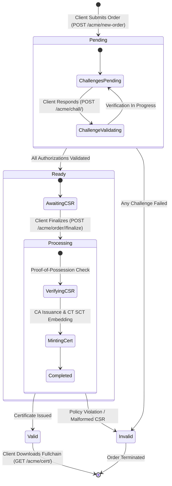
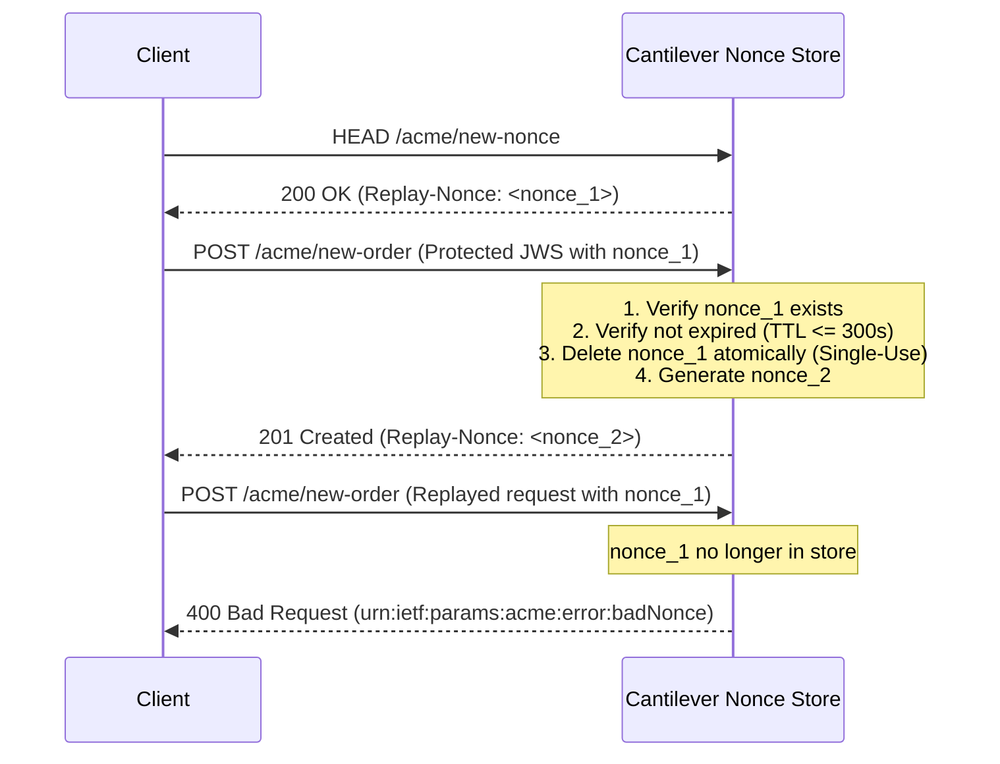

# RFC 8555 ACME v2 Protocol Implementation Specification

## Overview

Cantilever implements a fully autonomous Automatic Certificate Management Environment (ACME v2) server according to IETF RFC 8555. The ACME protocol allows automated software agents (such as Certbot, Lego, or Traefik) to prove control over domain names, manage cryptographic keys, and obtain signed X.509 certificates without human intervention.



---

## 1. Directory Endpoints and Discovery

A client begins the ACME workflow by querying the directory resource:

```http
GET /directory HTTP/1.1
Host: ca.example.com
```

Response (`application/json`):

```json
{
  "newNonce": "http://ca.example.com/acme/new-nonce",
  "newAccount": "http://ca.example.com/acme/new-account",
  "newOrder": "http://ca.example.com/acme/new-order",
  "revokeCert": "http://ca.example.com/acme/revoke-cert",
  "keyChange": "http://ca.example.com/acme/key-change",
  "meta": {
    "termsOfService": "http://ca.example.com/terms",
    "website": "http://ca.example.com"
  }
}
```

---

## 2. Anti-Replay Nonce Management (RFC 8555 Section 6.5)

To prevent replay attacks on JWS requests, the ACME server issues cryptographically random base64url nonces.



Cantilever enforces single-use semantics:
* Nonce generation produces 16 bytes of cryptographic entropy formatted as a URL-safe base64 string.
* Nonces are stored with a timestamp and expire after 300 seconds (5 minutes).
* Consuming a nonce is an atomic removal operation.
* Every response to a POST request includes a fresh `Replay-Nonce` header to allow immediate subsequent requests.

---

## 3. Account Management and Key Rollover

### 3.1 Registration (RFC 8555 Section 7.3)
Clients submit a POST request containing a JWS payload:
* `termsOfServiceAgreed`: `true`
* `contact`: Array of `mailto:` URIs.
* `onlyReturnExisting`: Optional boolean to check existing registrations.

### 3.2 Key Rollover (RFC 8555 Section 7.5)
An account owner can rotate their account private key without invalidating existing orders or certificates. The request requires dual JWS signatures:
1. Outer JWS signed by the existing account key.
2. Inner JWS signed by the new replacement key.

---

## 4. Challenge Verification Engines (RFC 8555 Section 8)

### 4.1 Key Authorization Computation
The key authorization string binds the challenge token to the client's public key thumbprint:
$$\text{keyAuthorization} = \text{token} \mathbin{\Vert} \text{"."} \mathbin{\Vert} \text{base64url}(\text{SHA-256}(\text{JWK}(K)))$$

### 4.2 HTTP-01 Challenge
* The client provisions a resource at `http://<domain>/.well-known/acme-challenge/<token>`.
* The server performs an HTTP GET request to verify that the returned body matches `keyAuthorization`.

### 4.3 DNS-01 Challenge
* The client publishes a DNS `TXT` record at `_acme-challenge.<domain>`.
* The expected record value is the URL-safe base64 SHA-256 digest of the key authorization:
  $$\text{TXT} = \text{base64url}(\text{SHA-256}(\text{keyAuthorization}))$$

---

## 5. Order Finalization and Issuance

Once all authorizations transition to `valid`, the order transitions to `ready`.
1. The client submits a PKCS#10 Certificate Signing Request (CSR) via `POST /acme/order/<id>/finalize`.
2. Cantilever verifies the self-signature proof-of-possession on the CSR.
3. Cantilever verifies that the requested Subject Alternative Names match the validated order identifiers.
4. The Certificate Authority mints the certificate, generates the Precertificate, collects Certificate Transparency Signed Certificate Timestamps (SCTs), embeds the SCT extension (OID `1.3.6.1.4.1.11129.2.4.2`), signs the final certificate, and makes the PEM fullchain available for download.
