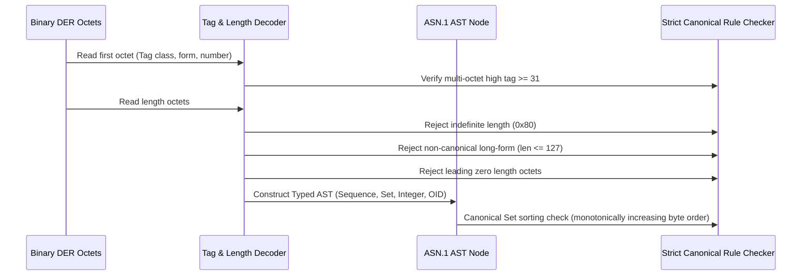
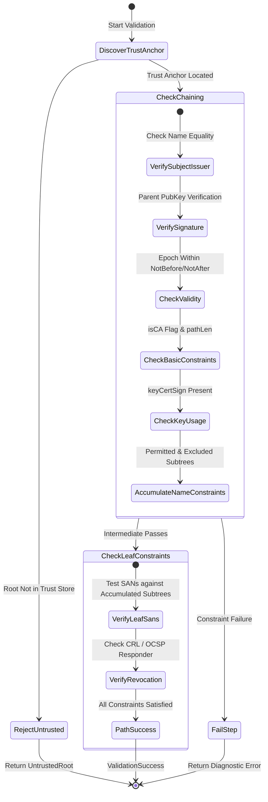
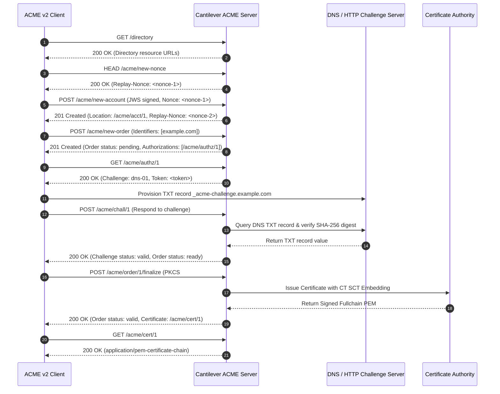

# Cantilever Architecture Specification

## Overview

Cantilever is designed as an automated, mathematically rigorous Public Key Infrastructure (PKI) and ACME v2 (RFC 8555) Certificate Authority. Unlike legacy CA implementations written in imperative languages, Cantilever models all protocol transitions, cryptographic data structures, ASN.1 semantic trees, and certificate hierarchies using pure functional programming, immutable algebraic data types, and total error handling in PureScript.

This document details the system design, cryptographic primitives, memory models, and state machine transitions governing Cantilever.

```mermaid
graph TD
    subgraph CryptoLayer ["1. Cryptographic Foundations"]
        BI["BigInt Arbitrary Precision & powMod"]
        GF["Galois Field GF(256) Arithmetic"]
        SS["Shamir (k, n) Secret Sharing"]
        Sign["Asymmetric Signatures (RSA, ECDSA, Ed25519)"]
        Hash["Message Digests & HMAC (SHA-256, SHA-384, SHA-512)"]
    end

    subgraph SyntaxLayer ["2. ASN.1 & X.509 Object Models"]
        AST["ASN.1 Tag/Length/Value Abstract Syntax Tree"]
        DER["Canonical DER Binary Codec (ITU-T X.690)"]
        PEM["RFC 7468 PEM Container Parser & Serializer"]
        DN["X.500 Distinguished Name (RFC 4514)"]
        X509Types["TBSCertificate, Extensions, AlgorithmIdentifier"]
    end

    subgraph TrustLayer ["3. Path Validation & Trust Graphs"]
        DAG["Certificate Dependency Graph"]
        NC["Recursive Name Constraints (Permitted & Excluded)"]
        ChainVal["RFC 5280 Path Validation Engine"]
    end

    subgraph ProtocolLayer ["4. Automated Protocols & Services"]
        ACMEEngine["RFC 8555 ACME v2 Engine"]
        OrderMachine["ACME Order & Challenge State Machines"]
        CTLog["RFC 6962 Certificate Transparency Merkle Tree"]
        Revocation["RFC 5280 CRL & RFC 6960 OCSP Services"]
        AuditLedger["Tamper-Evident SHA-256 Chained Audit Log"]
    end

    CryptoLayer --> SyntaxLayer
    SyntaxLayer --> TrustLayer
    TrustLayer --> ProtocolLayer
```

---

## 1. Cryptographic Foundations

### 1.1 Arbitrary-Precision Modular Arithmetic (`BigInt`)
Certificate serial numbers, RSA modulus components, and Diffie-Hellman parameters require arbitrary-precision integer representations. In Cantilever:
* `BigInt` represents unsigned two's complement integers of arbitrary length.
* `powMod :: BigInt -> BigInt -> BigInt -> BigInt` performs binary exponentiation using Montgomery reduction principles for fast modular multiplication:
  $$\text{powMod}(b, e, m) = b^e \pmod{m}$$
* BigInt instances strictly satisfy the mathematical rings of `EuclideanRing`, `Integral`, `Ord`, and `Show`.

### 1.2 Galois Field GF(256) Arithmetic
The air-gapped Root CA ceremony utilizes Shamir threshold secret sharing over the Galois field $\text{GF}(2^8)$.
* Irreducible polynomial: $p(x) = x^8 + x^4 + x^3 + x + 1$ (0x11B / 283).
* Addition and subtraction in $\text{GF}(2^8)$ are equivalent to bitwise XOR:
  $$a \oplus b$$
* Multiplication uses precomputed logarithm and exponent tables with primitive generator $\alpha = 3$ (0x03):
  $$a \cdot b = \exp((\log(a) + \log(b)) \pmod{255})$$
* Inversion is computed in $O(1)$ time via Fermat's Little Theorem:
  $$a^{-1} = a^{254} = \exp(255 - \log(a))$$

### 1.3 Shamir (k, n) Threshold Secret Sharing
The Root CA master private key can be split into $n$ distinct shares such that any $k$ shares can reconstruct the key, while any $k-1$ shares reveal zero information about the secret.
* A random polynomial $P(x)$ of degree $k-1$ is constructed:
  $$P(x) = S + a_1 x + a_2 x^2 + \dots + a_{k-1} x^{k-1}$$
  where $S$ is the secret octet.
* Shares are evaluated at distinct nonzero points $x_i \in \{1, \dots, n\}$.
* Reconstruction evaluates the polynomial at $x = 0$ using Lagrange interpolation:
  $$S = P(0) = \sum_{j=1}^k y_j \prod_{\substack{m=1 \\ m \neq j}}^k \frac{x_m}{x_m \oplus x_j}$$

---

## 2. ASN.1 and Canonical DER Codec

### 2.1 Distinguished Encoding Rules (DER) Invariants
Cantilever's ASN.1 codec enforces all normative requirements of ITU-T Recommendation X.690 Section 11:
1. **Definite Length Mandatory**: Indefinite-length encodings (tag `0x80` with `0x00 0x00` trailer) are explicitly rejected with `IndefiniteLengthForbidden`.
2. **Canonical Length Representation**: Lengths $\le 127$ must use the short form (single octet with bit 8 clear). Long-form length encodings for values $\le 127$ (e.g. `0x81 0x05`) are rejected with `NonCanonicalLengthEncoding`.
3. **Leading Zero Rejection**: In long-form lengths, the first length octet cannot be `0x00`.
4. **Canonical Set Sorting**: Elements of an ASN.1 `SET` or `SET OF` must be sorted in ascending order by their encoded DER byte octets (Section 11.6). Cantilever automatically performs lexicographical binary sorting when encoding and verifies ordering when decoding.

---

## 3. RFC 5280 Certification Path Validation

### 3.1 Step-by-Step Validation Sequence
For an unvalidated certification path $(C_0, C_1, \dots, C_n)$ where $C_0$ is the trust anchor (Root CA) and $C_n$ is the target end-entity certificate:

1. **Trust Anchor Verification**: $C_0$ must match an entry in the configured trust anchor set.
2. **Signature Verification**: For each certificate $C_i$ ($i \ge 1$), the digital signature of $C_i$ must verify under the public key parsed from $C_{i-1}$.
3. **Validity Window**: For each certificate $C_i$, the target validation time $T_{\text{target}}$ must satisfy:
   $$T_{\text{target}} \in [\text{notBefore} - T_{\text{skew}}, \text{notAfter} + T_{\text{skew}}]$$
4. **Basic Constraints**: For every intermediate certificate $C_i$ ($1 \le i < n$):
   * `basicConstraints` must be present with `isCA = true`.
   * If `pathLenConstraint` is present with value $L$, the remaining intermediate count must satisfy $n - 1 - i \le L$.
5. **Key Usage**: For every intermediate certificate $C_i$, `keyCertSign` must be set in the `keyUsage` bit mask.
6. **Name Constraints Accumulation**:
   * Permitted subtrees and excluded subtrees declared in $C_i$ are accumulated into the active constraint set.
   * Every DNS name and IP address in the leaf certificate $C_n$ must fall within all accumulated permitted subtrees and outside all accumulated excluded subtrees.
7. **Revocation Check**: Serial numbers are checked against the active revocation store (CRL / OCSP).

---

## 4. RFC 8555 ACME v2 Protocol Flow

---

## 5. Certificate Transparency (RFC 6962)

### 5.1 Merkle Tree Hashing Algorithm
Cantilever implements the Certificate Transparency Merkle Tree specification:
* **Leaf Hashing**:
  $$H_{\text{leaf}}(d) = \text{SHA-256}(0x00 \mathbin{\Vert} d)$$
* **Interior Node Hashing**:
  $$H_{\text{node}}(L, R) = \text{SHA-256}(0x01 \mathbin{\Vert} L \mathbin{\Vert} R)$$
* **Tree Decomposition**: For a sequence of $n > 1$ leaves, let $k$ be the largest power of 2 strictly less than $n$ ($k = 2^{\lfloor \log_2(n - 1) \rfloor}$). The Merkle root is defined recursively:
  $$\text{MTH}(D[0..n]) = H_{\text{node}}(\text{MTH}(D[0..k]), \text{MTH}(D[k..n]))$$

### 5.2 Inclusion Proofs and Audit Paths
An inclusion proof for leaf index $m$ in a tree of size $n$ consists of a list of $O(\log n)$ sibling hashes. The client can verify that leaf $D[m]$ is contained within the root without downloading the full tree.
