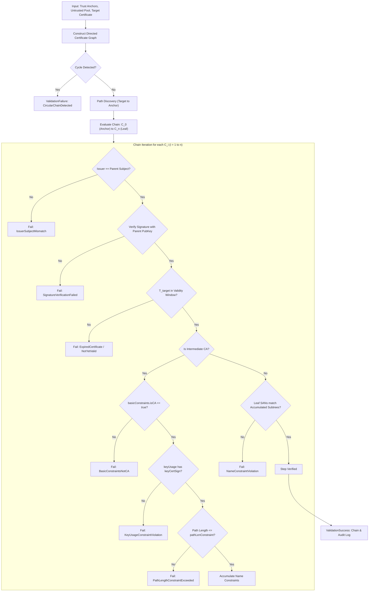

# RFC 5280 Certification Path Validation Specification

## Overview

The X.509 Public Key Infrastructure (PKIX) certification path validation algorithm defined in RFC 5280 Section 6 establishes whether a certificate is trusted for a given purpose at a given time. Cantilever provides a complete, purely functional implementation of this algorithm in `Cantilever.Core.Path.Validator`.



---

## 1. Data Structures and Inputs

The validation engine accepts a typed configuration:

```purescript
type ValidationConfig =
  { trustAnchors     :: Array Certificate
  , targetTime       :: Int
  , clockSkewSeconds :: Int
  , maxPathLength    :: Int
  , checkRevocation  :: Boolean
  }
```

* `trustAnchors`: Set of trusted Root CA certificates.
* `targetTime`: Epoch seconds at which the path is evaluated.
* `clockSkewSeconds`: Allowable clock drift window (default 600s / 10 min).
* `maxPathLength`: Maximum intermediate chain depth (default 5).
* `checkRevocation`: Toggle for active CRL and OCSP responder checking.

---

## 2. Basic Constraints Processing (RFC 5280 Section 4.2.1.9)

Every intermediate CA certificate in the path must include the `basicConstraints` extension marked `critical = true` with `isCA = true`.

### Path Length Constraint (`pathLenConstraint`)
The `pathLenConstraint` field specifies the maximum number of non-self-issued intermediate certificates that may follow this certificate in a valid certification path.
* If `pathLenConstraint = 0`, the certificate may only issue end-entity leaf certificates.
* If a path contains $m$ intermediate certificates after an intermediate declaring limit $L$, validation fails if $m > L$ with:
  ```purescript
  PathLengthConstraintExceeded { subject, limit: L, depth: m }
  ```

---

## 3. Name Constraints Processing (RFC 5280 Section 4.2.1.10)

The `nameConstraints` extension specifies a namespace within which all subject names in subsequent certificates in a certification path must be located.

### 3.1 Permitted Subtrees
If `permittedSubtrees` is present, each name in the leaf certificate must match at least one permitted subtree for each declared name type:
* **DNS Names**: A DNS name `api.example.com` matches permitted subtree `.example.com` or `example.com`. It does not match `.other.com`.
* If a leaf declares a DNS SAN that does not match any permitted subtree in the accumulated set, validation fails with `NameConstraintPermittedViolation`.

### 3.2 Excluded Subtrees
If `excludedSubtrees` is present, no name in the leaf certificate may match any excluded subtree:
* If a leaf declares `internal.example.com` and an intermediate declares excluded subtree `.internal.example.com`, validation fails with `NameConstraintExcludedViolation`.

---

## 4. Key Usage Constraints (RFC 5280 Section 4.2.1.3)

* **Intermediate CAs**: Must assert the `keyCertSign` bit in `keyUsage`. If absent, validation fails with `KeyUsageConstraintViolation { missingFlag: KeyCertSign }`.
* **CRL Issuers**: Must assert the `cRLSign` bit in `keyUsage` when signing Certificate Revocation Lists.
* **End-Entity Leaf Certificates**: Must assert `digitalSignature` and/or `keyEncipherment` depending on their Extended Key Usage (EKU) profile.

---

## 5. Audit Logging and Observability

Every execution of the validation engine produces an immutable, ordered audit log:

```purescript
type ValidationStepLog =
  { depth           :: Int
  , subject         :: DistinguishedName
  , issuer          :: DistinguishedName
  , stepDescription :: String
  , passed          :: Boolean
  }
```

This guarantees complete traceability of validation decisions, ensuring transparent debugging and cryptographic accountability.
